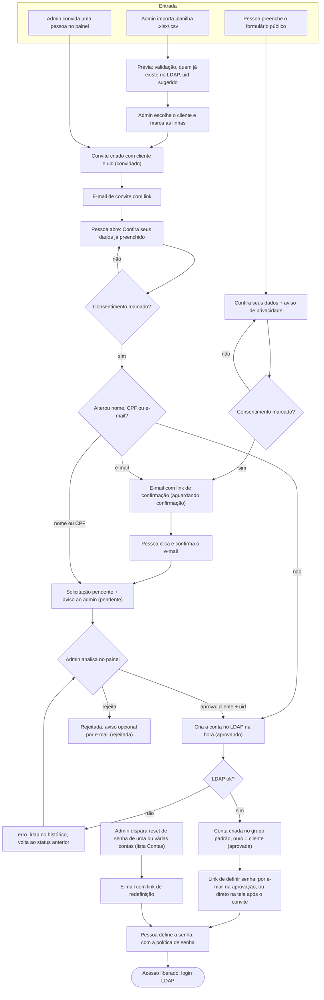

# ldap-self-signup

Serviço web em container para **autocadastro com aprovação** de contas em qualquer diretório OpenLDAP com contas
`posixAccount`: a pessoa preenche um formulário,
confirma o e-mail e dá o consentimento (LGPD), o admin aprova no painel `/admin` escolhendo o cliente, e a pessoa
define a própria senha por um link de uso único (o admin também pode disparar o reset de senha de qualquer conta).
Depois disso a pessoa tem uma **área própria** (`/entrar`, `/minha-conta`) com seus dados, grupos e links, e pode
pedir a correção dos dados e redefinir a senha sozinha.

Arquitetura e fluxos com diagramas: [`docs/ARQUITETURA.md`](docs/ARQUITETURA.md).

## Fluxo do procedimento

Do pedido de acesso (ou convite) até a conta no LDAP com a senha definida pela própria pessoa. Os rótulos entre
parênteses são os status da solicitação no painel; tudo fica registrado no histórico da solicitação.



Links de confirmação, convite e definição de senha são de uso único e expiram (24h; convite em `CONVITE_TTL_DIAS`).
Link usado, expirado ou cancelado mostra "link inválido".

## Área do usuário

- **Boas-vindas:** `GET /` é a página inicial (título com o nome da plataforma, botão **Solicitar acesso**, "Já tem
  conta? Entrar" e "Esqueci minha senha"). O formulário de cadastro fica em `GET /cadastro`, e o envio para revisão
  em `POST /cadastro` (`POST /` não existe mais).
- **Entrar:** `/entrar` valida usuário e senha por bind no LDAP (qualquer conta, sem exigir grupo). A sessão do
  usuário (`usuario`) é **independente da sessão do admin**: entrar como usuário não derruba um painel aberto no
  mesmo navegador, e vice-versa. Cada login gera um token CSRF novo e conta no `RATE_LIMIT_LOGIN`. `/sair` encerra só
  a sessão do usuário.
- **Minha conta:** `/minha-conta` mostra, lidos do LDAP, usuário, nome, **CPF mascarado**, e-mail, telefone, cliente e
  os grupos da conta, os serviços do `tema.toml` (`[links]`, exibidos como cards com ícone) e os botões **Trocar senha** e **Pedir correção dos dados**. Havendo
  correção ainda em aberto, a home avisa: "Correção em análise" (pendente) ou "Confirme seu novo e-mail"
  (aguardando confirmação).
- **Trocar a senha:** `/minha-conta/senha` pede a senha atual, a nova e a confirmação. A senha atual é conferida por
  bind no LDAP (errada = erro sem trocar nada) e a nova segue a mesma política de senha da definição por link. Conta
  no `RATE_LIMIT_LOGIN`. Ao trocar, os links de definir senha que a conta tinha em aberto deixam de valer e a
  auditoria registra `senha_alterada`. A sessão continua aberta.
- **Correção pela home:** `/minha-conta/corrigir` usa o mesmo formulário e consentimento da correção por link
  (`confirmar_dados`). Sem mudança real nada é criado. Com mudança nasce uma solicitação de **alteração** para o
  admin, que aprova ou rejeita como antes.
- **Login automático:** ao definir a senha (cadastro aprovado, convite, reset ou confirmação de dados) a pessoa já
  entra em `/minha-conta`; não há mais a tela "Senha definida". Usar um link de definir senha invalida os outros
  links de definir senha em aberto da mesma conta.
- **Esqueci minha senha:** `/esqueci-senha` pede o e-mail cadastrado e envia o e-mail `reset_senha` com o link
  para definir a senha nova. A resposta é **sempre a mesma**, exista o e-mail ou não, para não revelar quais
  e-mails estão cadastrados. O envio roda em segundo plano, há um **intervalo de 15 minutos por conta** (pedidos
  dentro dele são ignorados e auditados como `esqueci_senha · ignorado (intervalo)`) e o pedido **não invalida** os
  links que a conta já tinha, para que ninguém consiga sabotar o link de outra pessoa digitando o e-mail dela.
  Limitado por `RATE_LIMIT_FORM` por IP.
- **E-mail novo precisa ser confirmado:** na correção de dados (pelo link ou pela home), se o e-mail informado
  difere do da conta, a alteração fica `aguardando_confirmacao` e o e-mail `confirmar_email` vai para o **endereço
  novo**. O admin só é avisado, e a alteração só vira `pendente`, depois que a pessoa abre o link de confirmação
  (`/confirmar-email/<token>`). Falha no envio remove a alteração e mostra erro. Fluxos em
  [`docs/ARQUITETURA.md`](docs/ARQUITETURA.md).

## Rodar os testes

Nada roda no host além do Docker. Os testes rodam no container `tests`, com o código montado em `/srv`.

```bash
# unitários
docker compose -f compose.test.yml run --rm --no-deps tests pytest tests/unit -q
# integração (sobe openldap e mailpit)
docker compose -f compose.test.yml run --rm tests pytest tests/integracao -q
# limpeza
docker compose -f compose.test.yml down
```

Só é preciso `docker compose -f compose.test.yml build tests` quando `requirements*.txt` mudar.

## Build

```bash
docker build --target prod --build-arg APP_VERSION=x.y.z -t ldap-self-signup:x.y.z -t ldap-self-signup:latest .
```

Versionamento SemVer (`x.y.z`), com `latest` sempre na última versão. **Nunca sobrescreva uma tag de versão
existente**: uma correção ou feature é uma nova versão. A primeira linha do log do container é
`ldap-self-signup <versão> iniciando`. Healthcheck em `/healthz`.

## Configuração

### LDAP por arquivo (`ldap.toml`)

A configuração do LDAP de cada deploy pode ficar num arquivo `ldap.toml`, montado **só leitura** em `/config`
(caminho em `LDAP_CONFIG`, padrão `/config/ldap.toml`). Exemplo:
[`config-exemplo/ldap.toml`](config-exemplo/ldap.toml).

```toml
[servidor]
url = "ldaps://ldap.exemplo.org:636"
bind_dn = "cn=admin,dc=exemplo,dc=org"
bind_pw_file = "/run/secrets/ldap_bind_pw"   # Docker secret; a senha nunca vai no arquivo

[contas]
base = "ou=Users,dc=exemplo,dc=org"
grupo_padrao = "cn=Usuario,ou=Groups,dc=exemplo,dc=org"
gid_padrao = 10000                            # opcional, padrão 10000

[admins]
uids = ["admin"]                              # quem pode entrar no /admin
grupo = ""                                    # opcional: memberUid deste grupo também é admin
```

- **Precedência:** se o arquivo existe, ele é a única fonte da configuração de LDAP; `LDAP_URL`, `LDAP_BIND_DN`,
  `LDAP_BIND_PW_FILE`, `LDAP_USERS_BASE`, `LDAP_DEFAULT_GROUP_DN`, `LDAP_DEFAULT_GID`, `ADMIN_GROUP_DN` e `ADMIN_UIDS`
  são ignoradas e a partida loga `configuração de LDAP lida de <caminho>` (sem valores). Sem o arquivo, valem as
  variáveis abaixo.
- **Validação na partida:** `url`, `bind_dn`, `bind_pw_file`, `base` e `grupo_padrao` obrigatórios; `gid_padrao`
  inteiro; `uids` lista de uids válidos. Seção ou chave desconhecida, uma chave `bind_pw` (senha no arquivo) ou
  arquivo de senha vazio impedem a app de subir.
- Mudar o arquivo exige recriar o container (lido na partida).

### Admins

É admin quem está na lista (`ADMIN_UIDS` / `[admins].uids`) **ou** é `memberUid` do grupo (`ADMIN_GROUP_DN` /
`[admins].grupo`), e entra com a própria senha LDAP (bind do usuário; a conta precisa existir). Pelo menos um dos
dois precisa estar configurado, senão a app não sobe.

### Variáveis de ambiente

Segredos são lidos **só por arquivo** (`*_FILE`, ex.: Docker secret). Booleanos aceitam
somente `true` ou `false`. A app não sobe se uma variável obrigatória faltar, se um valor for inválido ou se o
`privacidade.md` do template estiver ausente.

| Variável | Obrigatória | Padrão | Descrição |
|---|---|---|---|
| `PUBLIC_URL` | sim | — | URL pública da app, usada nos links dos e-mails |
| `LDAP_CONFIG` | não | `/config/ldap.toml` | Arquivo de configuração do LDAP; se existir, substitui as variáveis `LDAP_*`/`ADMIN_GROUP_DN`/`ADMIN_UIDS` |
| `LDAP_URL` | sim¹ | — | URL do LDAP (`ldap://` ou `ldaps://`) |
| `LDAP_BIND_DN` | sim¹ | — | DN de bind com permissão de escrita |
| `LDAP_BIND_PW_FILE` | sim¹ | — | Arquivo com a senha do bind (definida no compose: `/run/secrets/ldap_bind_pw`) |
| `LDAP_USERS_BASE` | sim¹ | — | Base onde as contas são criadas |
| `LDAP_DEFAULT_GROUP_DN` | sim¹ | — | Grupo ao qual toda conta nova é adicionada |
| `LDAP_DEFAULT_GID` | não | `10000` | `gidNumber` primário das contas novas |
| `ADMIN_UIDS` | ² | vazio | Uids que acessam o `/admin`, separados por vírgula (ex.: `admin,fulano`) |
| `ADMIN_GROUP_DN` | ² | vazio | Grupo cujos membros (`memberUid`) também acessam o `/admin` |
| `ADMIN_NOTIFY_EMAIL` | sim | — | Destino do aviso de nova solicitação |
| `SMTP_HOST` | sim | — | Servidor SMTP |
| `SMTP_PORT` | não | `587` | Porta SMTP |
| `SMTP_USER` | não | vazio | Usuário SMTP (vazio = sem autenticação) |
| `SMTP_PASSWORD_FILE` | não | — | Arquivo com a senha SMTP |
| `SMTP_FROM` | sim | — | Remetente dos e-mails |
| `SMTP_STARTTLS` | não | `true` | `true`/`false` (estrito) |
| `SMTP_TLS_VERIFY` | não | `true` | `true`/`false`: verifica o certificado no STARTTLS |
| `SECRET_KEY_FILE` | sim | — | Arquivo com a chave de sessão (definida no compose: `/run/secrets/secret_key`) |
| `DATA_DIR` | não | `/data` | Pasta do banco SQLite |
| `TEMPLATE_DIR` | não | `/template` | Pasta com `tema.toml`, `privacidade.md`, e-mails |
| `TOKEN_TTL_HOURS` | não | `24` | Validade dos links por token |
| `CONVITE_TTL_DIAS` | não | `7` | Validade do link de convite, em dias (inteiro ≥ 1, validado na partida) |
| `RATE_LIMIT_FORM` | não | `10/hora` | Limite do formulário (`POST /cadastro`, `/confirmar` e `/esqueci-senha`) por IP (`N/<s\|min\|hora\|dia>`, com múltiplo opcional, ex. `10/15min`). Cada solicitação completa gasta 2 (envio + confirmação) |
| `RATE_LIMIT_LOGIN` | não | `10/15min` | Limite de tentativas de login (admin e `/entrar`) e, num contador separado, dos endpoints de token (`POST /confirmar`, `POST /confirmar-email/<token>`, `POST /definir-senha/<token>`, `POST /convite/<token>`, `POST /confirmar-dados/<token>[/corrigir]`, `POST /minha-conta/corrigir`) |
| `TRUSTED_PROXIES` | não | `1` | Quantos proxies confiar no `X-Forwarded-For` |
| `COOKIE_SECURE` | não | `true` | `true`/`false`: cookie de sessão só em HTTPS |
| `TIMEZONE_EXIBICAO` | não | `America/Sao_Paulo` | Fuso das datas exibidas no painel (`dd/mm/aaaa HH:MM`); nome IANA, validado na partida |

¹ Só quando não há `ldap.toml`. ² Pelo menos um dos dois (sem `ldap.toml`).

Comportamentos relevantes: o login SMTP (com `SMTP_USER`) é recusado sem STARTTLS. Falha no bind de serviço do LDAP
aparece como erro, não como "login inválido". O limite do formulário (`RATE_LIMIT_FORM`) vale também em `/confirmar`: cada solicitação completa (`POST /cadastro` +
`POST /confirmar`) consome 2 vagas, então `10/hora` permite 5 solicitações por IP por hora.

## Template por deploy

O tema é por deploy, montado em `/template` (somente leitura). O que faltar usa o padrão embutido na imagem.

```
/template
  tema.toml            # nome da plataforma, cores, logo, links (serviços), rodapé
  logo.png             # opcional: cabeçalho das páginas e embutido nos e-mails
  favicon.ico          # opcional: /favicon.ico (sem ele, ícone neutro da imagem)
  favicon.png          # opcional: 180×180, ícone PNG e apple-touch-icon (/tema/favicon.png)
  privacidade.md       # OBRIGATÓRIO: aviso de privacidade (LGPD), versionado pelo hash do conteúdo
  paginas/*.html       # opcional: sobrescreve páginas Jinja2 padrão
  emails/*.md          # opcional: confirmar_email, nova_solicitacao, conta_aprovada,
                       #           reset_senha, solicitacao_rejeitada, convite, convite_email,
                       #           confirmar_dados, dados_atualizados, alteracao_rejeitada, confirmar_email_conta
  emails/_layout.html  # opcional: layout HTML dos e-mails
```

Um `paginas/base.html` próprio deve ter `` logo depois do seu `<style>`. Esse
arquivo traz o CSS dos componentes do app (botões com ícone, checkbox, cards). Sem ele, os componentes que entrarem
em versões novas aparecem sem estilo no tema.

`privacidade.md` é obrigatório: o serviço não sobe sem ele. Trocar o arquivo gera uma nova versão do aviso nos
consentimentos. O template é lido na partida: **qualquer mudança no template exige reiniciar o container**. Exemplo pronto, sem logo nem favicon (o cabeçalho mostra o nome do tema), em [`templates-exemplo/exemplo/`](templates-exemplo/exemplo/).

### Serviços (`[links]`)

Os `[links]` do `tema.toml` aparecem em `/minha-conta` como **cards de serviços** com ícone (e nos e-mails
`conta_aprovada` e `reset_senha` como `rotulo`/`url`). Cada entrada é uma URL simples ou uma tabela:

```toml
[links]
"Webmail" = "https://mail.exemplo.org/"                       # forma simples: ícone escolhido pelo rótulo
"Arquivos" = { url = "https://nuvem.exemplo.org/", icone = "arquivos", descricao = "Seus arquivos na nuvem" }
"Suporte" = { url = "mailto:suporte@exemplo.org", descricao = "Fale com a equipe" }
```

- `url` (obrigatória) deve começar com `http://`, `https://`, `mailto:` ou `/`; qualquer outra coisa (como
  `javascript:`) faz o tema ser recusado na partida.
- `icone` (opcional) é um destes 9 nomes: `arquivos`, `senha`, `chat`, `email`, `wiki`, `painel`, `video`, `agenda`,
  `link`. Nome desconhecido recusa o tema.
- Sem `icone`, o ícone é escolhido pelo **rótulo**, sem diferenciar acento ou maiúsculas, pela primeira regra que
  casar: `arquivos` (arquivo, drive, nuvem, files), `senha` (senha, password), `chat` (chat, mensage, conversa),
  `email` (e-mail, email, correio, webmail), `wiki` (wiki, doc, manual, ajuda), `painel` (painel, dashboard, grafana,
  relat, monitor), `video` (reuni, video, meet, jitsi), `agenda` (agenda, calend). Sem correspondência, `link`.
- `descricao` (opcional) é uma frase curta mostrada sob o rótulo.

### E-mails

Cada `emails/<nome>.md` é markdown com placeholders Jinja2. A **primeira linha** deve ser `Assunto: ...`; logo abaixo,
antes da linha em branco, podem vir (em qualquer ordem):

- `Botao: <rótulo>` — mostra um botão com o `link` do e-mail. O botão só aparece se o `link` for `http://`/`https://`;
  o layout mostra também o endereço em texto, e a parte texto do e-mail termina com `<rótulo>: <link>`. Por isso o
  corpo não repete o link principal.
- `Motivo: <frase>` — linha do rodapé ("Você recebeu este e-mail porque ..."); sem ela, vale um texto padrão.

Os e-mails saem com parte texto e parte HTML. O HTML é o corpo em markdown encaixado em `emails/_layout.html` (do
`/template`, senão o layout neutro da imagem), renderizado com autoescape e com as variáveis `corpo_html`, `assunto`,
`botao`, `link` (vazios sem botão), `tema` (dados do `tema.toml`), `tem_logo` e `motivo_envio`. Use tabelas e CSS
inline (largura máx. 600px). Com `logo.png` no tema, a imagem vai embutida no e-mail e o layout a referencia como
``; nada é carregado de servidor externo. O tema de exemplo traz um layout pronto. Sem `logo.png`, o cabeçalho do e-mail mostra o nome do tema.

Outros links no corpo devem ser autolinks (`<{{ url }}>`): ficam clicáveis no HTML e o `_` dos tokens não vira
itálico. Placeholders:

| E-mail | Placeholders |
|---|---|
| `confirmar_email` | `plataforma`, `nome`, `link`, `validade` |
| `nova_solicitacao` (para o admin) | `plataforma`, `nome`, `email`, `link`, `alteracao` (só definida em correção de dados) |
| `conta_aprovada` | `plataforma`, `nome`, `uid`, `link`, `validade`, `links` (itera `rotulo`/`url`) |
| `reset_senha` | `plataforma`, `nome`, `uid`, `link`, `validade`, `links` (itera `rotulo`/`url`) |
| `solicitacao_rejeitada` | `plataforma`, `nome`, `motivo` |
| `convite` | `plataforma`, `nome`, `link`, `validade_dias`, `convidado_por` (uid do admin) |
| `convite_email` | `plataforma`, `link`, `validade_dias`, `convidado_por` (uid do admin) |
| `confirmar_dados` | `plataforma`, `nome`, `uid`, `link`, `validade` |
| `confirmar_email_conta` | `plataforma`, `nome`, `uid`, `link`, `validade` |
| `dados_atualizados` | `plataforma`, `nome`, `uid`, `link`, `validade` |
| `alteracao_rejeitada` (ao e-mail atual do LDAP) | `plataforma`, `nome`, `motivo` |

## Comportamentos do fluxo

- A aprovação reivindica a solicitação de forma atômica (status `aprovando`), evitando aprovação dupla. A rejeição também
  é atômica: só rejeita o que ainda está `pendente`.
- A lista `/admin/` mostra todas as solicitações, 25 por página, com busca por trecho em todos os campos (`?q=`, CPF
  com ou sem pontuação) e badges de status com contagem (`?status=`, padrão `pendente`).
- Cada solicitação tem um **Histórico** no detalhe (tabela `auditoria`, `alvo = sol:<id>`): criação, confirmação,
  aprovação (uid, cliente, uidNumber), bloqueios, erros de LDAP com a mensagem, envio/falha de e-mails, rejeição,
  destravar e senha definida. Erros aparecem destacados.
- Uma solicitação presa em `aprovando` (processo interrompido no meio da aprovação) gera o aviso
  "N solicitações em aprovação — verificar" na lista. Depois de conferir no LDAP se a conta foi criada, o botão **Voltar para pendente**
  (`POST /admin/solicitacao/<id>/destravar`) a devolve a `pendente` e registra `destravar` na auditoria.
- **Pedido novo e CPF repetido:** um pedido novo só encerra (`expirada`) um pedido anterior em aberto quando tem o
  **mesmo CPF e o mesmo e-mail** e depois que o e-mail novo está comprovado: na confirmação do e-mail (cadastro
  público e convite com e-mail alterado) ou na hora (convite aceito com o e-mail do convite e convite por e-mail
  preenchido). Quem só conhece o CPF de alguém não consegue cancelar o pedido dessa pessoa; CPF igual com e-mail
  diferente deixa os dois pedidos para o admin, que vê o conflito no detalhe.
- Cliente (`ou`) desconhecido exige a confirmação "cliente novo". Conflito de uid bloqueia, conflito de CPF/e-mail exige confirmar "é outra pessoa".
- Falha ao avisar a rejeição por e-mail é exibida no painel. Falha ao enviar o link após criar a conta deixa `link_enviado=false` e habilita "reenviar link".
- `memberUid` antigo no grupo padrão é tolerado ao criar a conta.
- Confirmação de e-mail é GET (página) + POST (botão), protegendo o token de pré-carregamento de links.

### Convites

O admin também pode iniciar o cadastro em **Convidar** (`/admin/convidar`): nome, CPF, e-mail, telefone, cliente e uid
(vazio = nome + último sobrenome). Valem as regras da aprovação: uid em uso no LDAP bloqueia, CPF/e-mail já
existentes exigem "é outra pessoa", cliente novo exige confirmação. O convite vira uma solicitação com origem
`convite` e status **Convidado**, e a pessoa recebe o e-mail `convite` com um link válido por `CONVITE_TTL_DIAS`.
Um convite novo para o mesmo CPF cancela o anterior; um uid já reservado por convite em aberto de outro CPF bloqueia.

- `GET /convite/<token>` abre "Confira seus dados" com os campos editáveis já preenchidos e o consentimento desmarcado.
- Sem mudança em nome, CPF e e-mail, o `POST` cria a conta na hora (cliente e uid do convite, ator `convite` no
  histórico) e leva direto a definir a senha. Se o LDAP falhar, o convite continua válido.
- Mudou nome ou CPF: a solicitação vira `pendente` para o admin (uid sugerido recalculado se o nome mudou; o
  histórico `convite_alterado` lista só os nomes dos campos e o uid do convite). Mudou o e-mail: vira
  `aguardando_confirmacao` e o e-mail novo precisa ser confirmado antes.
- No detalhe: origem, quem convidou, **Reenviar convite** (link novo, o anterior deixa de valer) e **Cancelar
  convite** (status `expirada`). Falha de SMTP deixa "link não enviado" no painel.
- Link usado, cancelado ou expirado mostra "link inválido".

### Convite por e-mail

Em **Convidar por e-mail** (`/admin/convidar-por-email`) o admin só precisa dos endereços: cola um ou vários
e-mails (separados por espaço, vírgula, ponto e vírgula ou quebra de linha), escolhe o **cliente** (`ou`; cliente novo
exige confirmação) e confere uma **prévia** antes de enviar. Quem preenche o resto é a pessoa.

- **Prévia:** uma linha por e-mail, sem repetir. E-mail inválido ou que **já tem conta** no LDAP (o usuário aparece
  na linha) é pulado, com o motivo. E-mail que já tem convite por e-mail em aberto é enviável e mostra a nota
  "substitui o convite #N". Limite de 200 e-mails enviáveis por vez.
- **Enviar:** cada e-mail enviável vira uma solicitação com origem `convite_email` e status **Convidado**, e a
  pessoa recebe o e-mail `convite_email` (`plataforma`, `link`, `validade_dias`, `convidado_por`) com link válido por
  `CONVITE_TTL_DIAS`. Um convite novo para o mesmo e-mail cancela o anterior. O resumo mostra enviado, falha de envio
  ou pulado, e o link de cada solicitação (reenviar e cancelar funcionam como nos outros convites).
- **O que a pessoa vê:** `GET /convite/<token>` abre o formulário com **nome, CPF e telefone** em branco e o
  **e-mail fixo** (o do convite, comprovado pelo link; não dá para trocar). O consentimento começa desmarcado e a
  justificativa é opcional.
- **Vai para aprovação:** ao enviar, a solicitação passa de `convidado` a `pendente` (o e-mail já está confirmado,
  então não há etapa de confirmação), o link é consumido e o admin recebe o e-mail `nova_solicitacao`. A conta só
  é criada quando o admin aprova, como no cadastro público; **não** nasce na hora como no convite com dados.
  Convidar uma pessoa por e-mail **não** cancela convites com dados do mesmo CPF.
- Auditoria: `convite_criado`, `convite_cancelado` (quando substitui), `convite_enviado` ou falha de envio e
  `convite_preenchido` (ator `convite`). Fluxo em [`docs/ARQUITETURA.md`](docs/ARQUITETURA.md).

#### Convites em lote

Em **Convidar → Convidar em lote** (`/admin/convidar/lote`) o admin envia uma planilha e confere uma prévia antes de
enviar os convites.

- **Formatos:** `.xlsx` (só a primeira folha com dados; fórmulas valem pelo valor salvo) ou `.csv` (UTF-8, Windows-1252 ou Latin-1,
  separador `,`, `;` ou tab). Outros tipos são recusados. Limites: **1 MB** e **500 linhas**.
- **Colunas:** nome, CPF, e-mail e telefone. A primeira linha pode ser um cabeçalho, reconhecido pelo nome sem
  diferenciar acento/maiúsculas (`nome`/`name`, `cpf`, `e-mail`/`email`, `telefone`/`fone`/`celular`), em qualquer
  ordem; sem cabeçalho, as colunas são lidas nessa ordem.
- **Normalização:** linhas vazias são ignoradas, espaços e quebras de linha sobrando são removidos, CPF numérico
  (`52998224725.0`, ou sem o zero à esquerda) vira 11 dígitos.
- **Telefone é opcional no lote:** o convite sai sem telefone e a pessoa informa o telefone na tela do convite (lá ele
  continua obrigatório). No convite individual o telefone segue obrigatório.
- **Prévia** (vale 1 hora, guardada no banco): uma linha por pessoa com os dados normalizados, uid sugerido (editável),
  erros e conflitos no LDAP. Linha com erro fica desmarcada e desabilitada; uid em uso, reservado por convite em
  aberto ou repetido no lote fica desmarcado até ser corrigido; quem já existe (CPF/e-mail) fica desmarcado e só é
  convidado marcando "é outra pessoa". O cliente é escolhido uma vez para o lote (cliente novo exige confirmação).
- **Enviar convites:** o servidor revalida cada linha marcada; o resumo mostra enviado / falha de envio / bloqueado
  (com o motivo) e o link de cada solicitação. A auditoria registra `lote_enviado` com as contagens.

### Contas

Em **Contas** (`/admin/contas`) o admin vê **todas** as contas do LDAP (`posixAccount` em `contas.base`), 25 por
página, ordenadas por usuário: usuário, nome, e-mail ("sem e-mail" em destaque), cliente (`ou`) e grupos (`cn` dos
`posixGroup` irmãos do grupo padrão onde a conta é `memberUid`; até 3, depois "+N").

- **Busca** (`?q=`) por trecho em usuário, nome, e-mail, cliente e CPF (da `description`, com ou sem pontuação), sem
  diferenciar maiúsculas e acentos.
- **Filtro por cliente** em badges (`?cliente=`): Todos, cada cliente existente e "Sem cliente", com a contagem para a
  busca atual. A lista vem de uma busca paginada no LDAP por requisição; filtro e paginação são feitos na aplicação.
- **Ficha da conta:** o ícone de olho ("Ver ficha da conta") abre `GET /admin/contas/<uid>`, lida do LDAP na hora:
  usuário, nome, **CPF completo**, e-mail, telefone, cliente e grupos, com os botões de pedir confirmação dos dados e
  enviar link de redefinição. Abaixo, as **solicitações ligadas à conta** (criadas por aprovação ou convite, e as
  correções de dados dela, com link para o detalhe) e o **histórico** da auditoria da conta e dessas solicitações,
  mais recente primeiro (até 300 linhas), com rótulos em português e as linhas de erro destacadas. Conta inexistente
  dá 404.
- **Informar o e-mail de uma conta:** na ficha, seção **E-mail** (`#email`), o admin digita o e-mail e envia
  (`POST /admin/contas/<uid>/email`); serve para conta "sem e-mail" e também para corrigir um e-mail existente. Na
  lista, "sem e-mail" é um link para essa seção. O e-mail **só é gravado no LDAP depois que a pessoa confirma** pelo
  link `/confirmar-email-conta/<token>` (e-mail `confirmar_email_conta`, enviado ao endereço novo, validade
  `TOKEN_TTL_HOURS`): ao confirmar, o `mail` é gravado e a pessoa segue direto para definir a senha. Até lá a ficha
  mostra "Aguardando confirmação". E-mail já usado por outra conta é recusado (409). Um segundo pedido substitui o
  pendente e invalida o link anterior. Falha de envio não altera nada e fica no histórico (`falha_envio_email`); o
  histórico registra também `email_solicitado` e `email_definido`.
- **Reset individual:** "Enviar link de redefinição" na linha (`POST /admin/contas/<uid>/reset`), como antes.
- **Reset em lote:** marque as contas (ou "Selecionar todas as N contas do filtro atual", que vale para todas as
  páginas) e clique em "Enviar link de redefinição às selecionadas". A tela de confirmação lista quem recebe o link e,
  separadas, as contas sem e-mail e as não encontradas, que serão puladas. Ao confirmar, cada conta com e-mail recebe
  um token novo (o anterior deixa de valer) e o e-mail `reset_senha`, em sequência. O resumo mostra enviados, falhas
  de envio e pulados.
- **Confirmação dos dados:** o ícone "Pedir confirmação dos dados" na linha (`POST /admin/contas/<uid>/confirmacao`) e
  o botão equivalente no lote (mesma seleção, mesma tela de confirmação, mesmo limite) enviam à pessoa o e-mail
  `confirmar_dados` com um link de uso único (`/confirmar-dados/<token>`). Contas sem e-mail são puladas. A pessoa
  vê os dados atuais do LDAP e, com o consentimento, escolhe: **dados corretos** segue direto para definir a senha
  (exige CPF e telefone no cadastro) e **preciso corrigir** abre um formulário. Se nada mudou de fato, é o mesmo que
  confirmar. Se mudou, nasce uma solicitação de **alteração** pendente, que o admin vê no painel (atual × novo) e
  aprova (atualiza o LDAP e envia o e-mail `dados_atualizados` com o link de definir senha) ou rejeita (o aviso vai ao
  e-mail atual do LDAP). **Cuidado:** aprovar uma alteração que muda o e-mail envia o link de definir senha ao e-mail
  novo, não verificado. Trate a troca de e-mail como o caso sensível. Os modelos
  `confirmar_dados`, `dados_atualizados` e `alteracao_rejeitada` podem ser sobrescritos pelo tema. Fluxo em
  [`docs/ARQUITETURA.md`](docs/ARQUITETURA.md).
- **Limite de 200 contas por envio:** acima disso o painel pede para filtrar por cliente ou busca e enviar em partes.
- A seleção é **recalculada no servidor** a cada passo: uids validados e conferidos no LDAP (ou o filtro refeito), e o
  e-mail sempre vem do LDAP, nunca do formulário. Auditoria: `reset_senha` por conta e `reset_lote` só com as contagens.

## Segurança

- Toda resposta leva `X-Frame-Options: DENY`, `Content-Security-Policy: frame-ancestors 'none'`,
  `X-Content-Type-Options: nosniff` e `Referrer-Policy: same-origin` (`same-origin` mantém o `Referer` que a checagem
  CSRF do Flask-WTF exige em HTTPS).
- O gunicorn roda **sem access log**: as URLs levam tokens (`/confirmar-email/<token>`, `/definir-senha/<token>`) e
  buscas do admin. O access log do Traefik continua disponível, mas também registra essas URLs: trate-o como sensível.

## Stack

As imagens são publicadas em `ghcr.io/marcelofmatos/ldap-self-signup` (tags `x.y.z`, `x.y`, `x` e `latest`). Um
deploy mínimo com Docker Compose, atrás de um proxy reverso com HTTPS:

```yaml
services:
  app:
    image: ghcr.io/marcelofmatos/ldap-self-signup:${IMAGE_TAG:-latest}
    env_file: .env                 # PUBLIC_URL, ADMIN_NOTIFY_EMAIL, SMTP_* etc. (ver Variáveis de ambiente)
    environment:
      LDAP_BIND_PW_FILE: /run/secrets/ldap_bind_pw
      SECRET_KEY_FILE: /run/secrets/secret_key
    secrets: [ldap_bind_pw, secret_key]
    volumes:
      - data:/data                 # SQLite
      - ./template:/template:ro    # tema (ex.: cópia de templates-exemplo/exemplo)
      - ./config:/config:ro        # ldap.toml (ex.: cópia de config-exemplo/ldap.toml)
    ports:
      - "8000:8000"
    restart: unless-stopped

secrets:
  ldap_bind_pw:
    file: ./secrets/ldap_bind_pw
  secret_key:
    file: ./secrets/secret_key

volumes:
  data:
```

Para rollback, aponte `IMAGE_TAG` para a versão anterior.
