# Arquitetura e fluxos

Visão técnica do `ldap-self-signup`: autocadastro com aprovação para qualquer diretório OpenLDAP com contas
`posixAccount`. Configuração e uso estão no [`README`](../README.md).

## 1. Arquitetura

O serviço é um único container (Flask + gunicorn, **1 réplica**, porque o rate limit é em memória). Fica atrás do
Traefik, fala com o OpenLDAP por LDAPS usando a conta de serviço e envia e-mails por SMTP. O estado (SQLite) fica no
volume `/data`. O tema do deploy fica em `/template` e a configuração do LDAP em `/config/ldap.toml`, ambos somente
leitura.

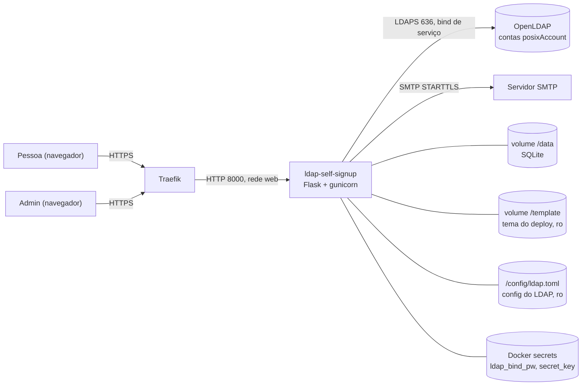

### Configuração do LDAP

Na partida, `carregar_config` procura `LDAP_CONFIG` (padrão `/config/ldap.toml`). Se o arquivo existe, ele é a única
fonte da configuração de LDAP e dos admins (as variáveis `LDAP_*`, `ADMIN_GROUP_DN` e `ADMIN_UIDS` são ignoradas, e a
partida loga só o caminho). A senha do bind nunca fica no arquivo: vem de `bind_pw_file` (Docker secret), e uma chave
`bind_pw` é recusada. Sem o arquivo, vale a configuração por variáveis (compatível com a 0.2).

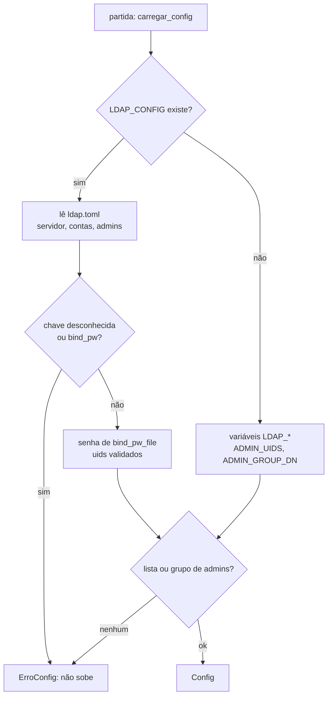

### E-mails

Cada e-mail é um `.md` com cabeçalho (`Assunto:` e, opcionais, `Botao:` e `Motivo:`). O corpo vira texto puro e HTML
(markdown sem HTML bruto); o HTML entra no `emails/_layout.html` do tema (ou no layout neutro da imagem), renderizado
com autoescape. O botão só aparece com rótulo e um `link` `http(s)`; nesse caso o link também vai ao fim da parte
texto. O logo do tema vai embutido (`cid:logo`), sem carregar nada de servidor externo.

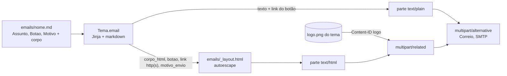

### Módulos

| Módulo | Responsabilidade |
|---|---|
| `app/config.py` | Lê as env vars e o `ldap.toml` (segredos só via `*_FILE`/`bind_pw_file`), valida na partida (booleanos estritos `true`/`false`, limites `N/unidade`, uids de admin, chaves do TOML) |
| `app/contas.py` | Regras puras: validação de CPF/telefone, derivação de uid, SSHA, montagem de atributos, política de senha |
| `app/banco.py` | SQLite: solicitações (incluindo a reivindicação atômica `aprovando`), avisos, consentimentos, tokens, auditoria e prévias de lote (`lotes`). Na partida adiciona as colunas novas (`origem`, `convidado_por`) a bancos de versões anteriores |
| `app/aprovacao.py` | Cria a conta de uma solicitação (reivindica, cria no LDAP, registra `aprovar`/`erro_ldap`); usado pela aprovação e pelo aceite de convite |
| `app/convites.py` | Cria o convite (substitui o convite em aberto do mesmo CPF) e o convite por e-mail (`criar_por_email`, substitui o do mesmo e-mail) e envia/reenvia o link, escolhendo o modelo `convite` ou `convite_email` pela origem |
| `app/lote.py` | Convites em lote: lê a planilha `.xlsx` (openpyxl, só leitura) ou `.csv` e monta a prévia por linha (validação, uid, conflitos) |
| `app/tokens.py` | Emite (`secrets.token_urlsafe(32)`), valida e consome tokens. Só o hash SHA-256 vai ao banco |
| `app/tema.py` | Carrega `/template` (tema.toml com `[links]` normalizados em serviços com ícone, privacidade.md, e-mails, páginas, logo, favicon) na partida, com fallback para o tema padrão da imagem. `Tema.email` renderiza o `.md` e o encaixa no `emails/_layout.html`, devolvendo `Email(assunto, texto, html, imagens)` |
| `app/correio.py` | Só envia por SMTP: `multipart/alternative` (texto + HTML); com logo, o HTML vai num `multipart/related` com a imagem em `Content-ID <logo>`. Recusa login SMTP sem TLS |
| `app/ratelimit.py` | Limite de requisições por IP, em memória |
| `app/diretorio.py` | Acesso ao LDAP via `ldap3`: buscas (uid/CPF/mail/ou), lista de contas com grupos (busca paginada), próximo uidNumber, criar conta, trocar senha, bind de login |
| `app/servicos.py` | Contêiner de serviços injetados (`Servicos`), acessor `svc()` e `ip_cliente()`. `Servicos.enviar` orquestra o envio (renderiza com `tema.email`, envia com `correio`) |
| `app/web/publico.py` | Boas-vindas (`/`), formulário (`/cadastro`), revisão, confirmação de e-mail, `/privacidade`, aceite de convite, confirmação e correção dos dados (helper `registrar_alteracao`), definir senha (com login automático), esqueci minha senha |
| `app/web/conta.py` | Área do usuário: `/entrar`, `/sair`, `/minha-conta`, `/minha-conta/corrigir`, `/minha-conta/senha` (sessão `usuario`) |
| `app/web/admin.py` | Login, lista/detalhe de solicitações, aprovar/rejeitar/reenviar/destravar, convidar (um a um, por e-mail e em lote)/reenviar/cancelar convite, lista de contas (busca, filtro por cliente) e reset de senha e confirmação dos dados, individuais e em lote |
| `app/wsgi.py` | Ponto de entrada do gunicorn: `create_app(carregar_config())` |

Como o template é lido na partida, mudanças em `/template` exigem reiniciar o container.

### Segurança transversal

- `create_app` registra um `after_request` que adiciona `X-Frame-Options: DENY`,
  `Content-Security-Policy: frame-ancestors 'none'`, `X-Content-Type-Options: nosniff` e `Referrer-Policy: same-origin`
  (`same-origin` preserva o `Referer` exigido pela checagem CSRF do Flask-WTF em HTTPS).
- O gunicorn roda sem access log, porque as URLs levam tokens e buscas do admin.
- Rate limit por IP, em memória: `RATE_LIMIT_FORM` em `POST /cadastro`, `POST /confirmar` (uma solicitação completa gasta 2
  vagas) e `POST /esqueci-senha`; `RATE_LIMIT_LOGIN` no login do admin, no `/entrar` do usuário e, num contador separado, nos endpoints de token (`POST /confirmar`,
  `POST /confirmar-email/<token>`, `POST /definir-senha/<token>`).
- Duas sessões independentes no mesmo cookie: `admin` e `usuario`. Nenhum login chama `session.clear()` (não derruba a
  outra sessão), mas cada login gera um token CSRF novo.

## 2. Fluxo: solicitação (público)

A pessoa preenche o formulário e vê uma tela de revisão (que não grava nada: os dados viajam num campo assinado
com `itsdangerous`). Só ao confirmar com o consentimento marcado a solicitação é gravada, junto com o consentimento e o
token. O e-mail de confirmação leva a uma página com um botão: o `GET` apenas valida o token e o `POST` o consome,
para que leitores de e-mail que pré-carregam links não gastem o token. A resposta pública é sempre a mesma, então não
revela se CPF ou e-mail já existem. O limite de requisições do formulário vale também em `/confirmar` (cada solicitação
completa gasta 2 vagas de `RATE_LIMIT_FORM`).

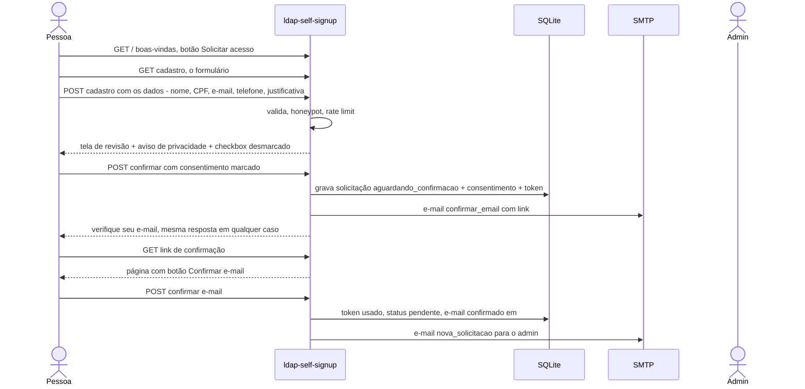

Se o SMTP falhar no envio do e-mail de confirmação, a solicitação é removida e a pessoa vê "tente mais tarde".
Uma nova solicitação para o mesmo CPF substitui a anterior, que vira `expirada` só depois do envio bem-sucedido.

## 3. Fluxo: aprovação (admin)

O login exige que a conta exista no LDAP (busca exata pelo uid) e que o uid esteja na lista de admins
(`ADMIN_UIDS` / `[admins].uids`) **ou** seja `memberUid` do grupo (`ADMIN_GROUP_DN` / `[admins].grupo`, se
configurado); só então faz o bind LDAP com o próprio usuário. Se o bind de serviço ou a consulta ao grupo falhar, o
painel mostra erro (não "login inválido"). Ao aprovar, o admin escolhe o cliente (`ou`) e o uid.
Um cliente desconhecido exige a confirmação "cliente novo". A aprovação **reivindica a solicitação de forma atômica**
(status `aprovando`), o que impede duas aprovações simultâneas da mesma solicitação. Se o LDAP falhar, o status volta
a `pendente`. Um `memberUid` antigo no grupo padrão (conta recriada) é tolerado.

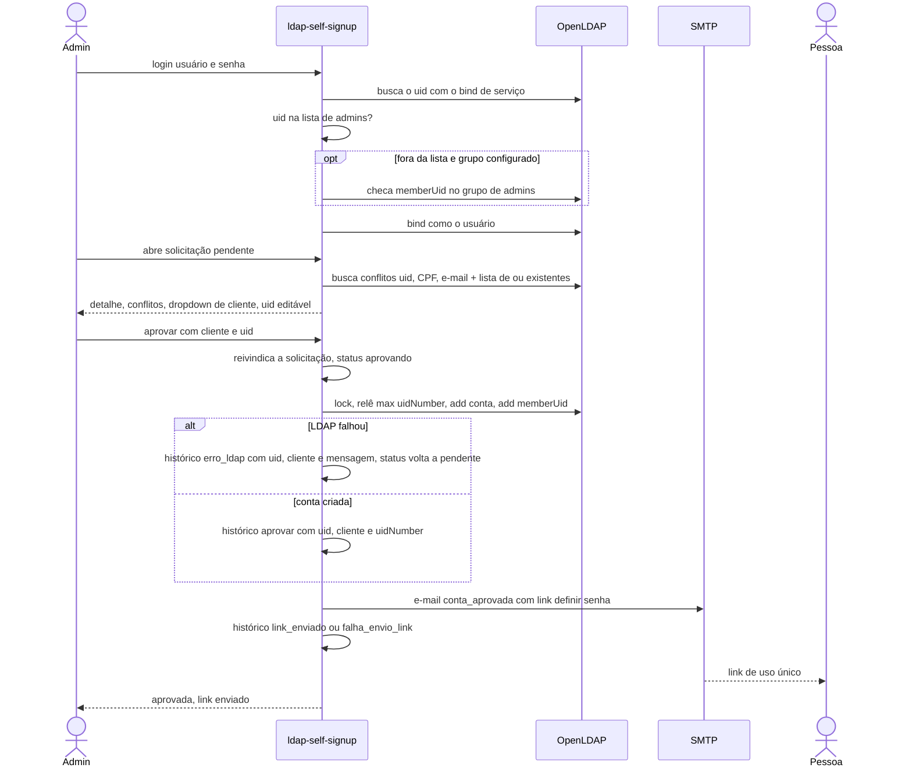

Ao rejeitar, o motivo é opcional e, se marcado "avisar", o e-mail `solicitacao_rejeitada` é enviado. A rejeição é
atômica (`UPDATE ... WHERE status='pendente'`): se a solicitação já foi reivindicada por uma aprovação, responde 409.
Se o envio do aviso falhar, o painel avisa. Se o SMTP falhar após criar a conta, a conta fica criada com `link_enviado=false` e o botão
**reenviar link** fica disponível.

Se o processo morrer entre a reivindicação e o fim da aprovação, a solicitação fica presa em `aprovando`. A lista
avisa "N solicitações em aprovação — verificar" (link para o filtro `status=aprovando`) e o detalhe oferece **Voltar para pendente** (`POST /admin/solicitacao/<id>/destravar`,
só com status `aprovando`, auditado como `destravar`). Antes, o admin confere no LDAP se a conta chegou a ser criada.

### Histórico da solicitação

Cada ação e falha ligada a uma solicitação vai para a tabela `auditoria` com `alvo = sol:<id>`: `solicitacao_criada`,
`email_confirmado`, `aprovar`, `aprovacao_bloqueada` (motivo), `erro_ldap` (uid, cliente e mensagem do LDAP, sem
senha), `link_enviado`/`falha_envio_link` (também no reenvio), `rejeitar`/`falha_envio_aviso`, `destravar` e
`senha_definida` (registrada também no `sol:<id>` da solicitação aprovada daquele uid). Convites acrescentam
`convite_criado`, `convite_enviado`/`falha_envio_convite`, `convite_aceito`, `convite_alterado` (só os nomes dos
campos) e `convite_cancelado`; no aceite o ator é `convite`. O detalhe mostra a seção
**Histórico** em ordem cronológica, com os erros destacados.

### Lista de solicitações

`/admin/` é uma lista única, mais recentes primeiro, 25 por página (`?pagina=N`; fora do intervalo cai na última).
`?q=` busca por trecho em todos os campos da solicitação (`LIKE ... ESCAPE` parametrizado, `%`/`_` literais; CPF
também só pelos dígitos). `?status=` filtra (padrão `pendente`, `todos` sem filtro) por badges com a contagem de cada
status para a busca atual. Busca e filtro se mantêm na paginação.

## 3b. Fluxo: convite (admin inicia o cadastro)

O admin cria o convite com os dados, o cliente e o uid. O link (token `convite`, `CONVITE_TTL_DIAS`) abre a mesma tela
"Confira seus dados", agora com campos editáveis. O consentimento só é registrado no aceite. Sem mudança em nome, CPF
e e-mail, a conta é criada na hora pela mesma rotina da aprovação (`app/aprovacao.py`, reivindicação atômica a partir
de `convidado`) e a pessoa vai direto definir a senha.

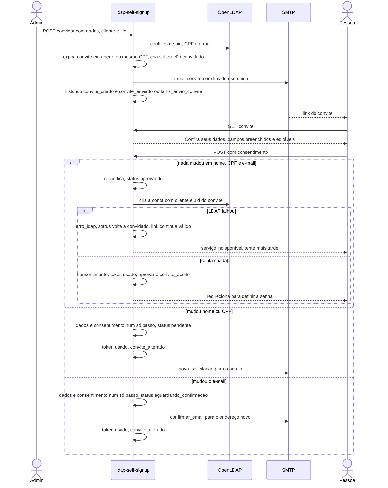

**Reenviar convite** emite um link novo e invalida o anterior. **Cancelar convite** passa a solicitação a `expirada` e
invalida o link. O prazo de `aguardando_confirmacao` conta do aceite do convite (último consentimento, gravado junto
com os dados antes do envio da confirmação), nunca da criação do convite. Se o SMTP falhar, o aceite é desfeito
(dados, status `convidado` e o consentimento daquele aceite).

## 3b2. Fluxo: convite por e-mail (v0.8)

O admin cola só os e-mails (`/admin/convidar-por-email`) e vê uma prévia: e-mail inválido ou que já tem conta no LDAP é
pulado, e o que já tem convite por e-mail em aberto mostra "substitui o convite #N". No envio cada e-mail vira uma
solicitação `convidado` com origem `convite_email`, e o convite anterior do mesmo e-mail é encerrado. A pessoa abre
`/convite/<token>`, preenche nome, CPF e telefone (o e-mail é fixo) e a solicitação vai para `pendente`: a conta só
nasce quando o admin aprova.

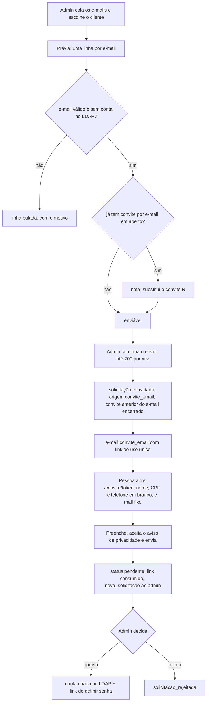

## 3c. Fluxo: convites em lote

O admin envia uma planilha `.xlsx` ou `.csv` em **Convidar em lote** (`/admin/convidar/lote`). `app/lote.py` lê a
planilha (cabeçalho opcional, CPF numérico normalizado, linhas vazias ignoradas) e a prévia fica na tabela `lotes` por
1 hora (as expiradas são apagadas a cada acesso; cada admin só vê as suas). Na prévia, cada linha é validada e
comparada com o LDAP; no envio o servidor revalida só as linhas marcadas e cria cada convite com `convites.criar`
(mesmo histórico do convite individual). O lote é apagado no envio, então não pode ser enviado duas vezes.

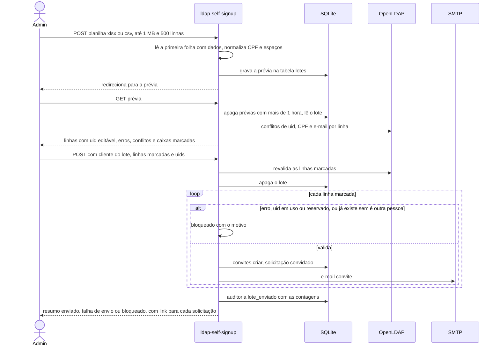

## 4. Fluxo: reset de senha e definir senha

O admin escolhe uma ou várias contas na lista **Contas** (qualquer uma da base, inclusive as criadas pela CLI). A lista
vem de uma busca paginada (`posixAccount` em `contas.base`) mais uma busca dos `posixGroup` no pai do grupo padrão,
por requisição; busca por trecho, filtro por cliente e paginação são feitos na aplicação. Sem `mail` na conta, o reset
individual é bloqueado e o em lote a pula. O lote passa por uma tela de confirmação, tem limite de 200 contas e é
recalculado no servidor (uids validados e conferidos no LDAP, ou o filtro refeito), com o e-mail sempre lido do LDAP.
O link de uso único, válido por `TOKEN_TTL_HOURS`, serve tanto ao reset quanto à conta recém-aprovada (os e-mails
`conta_aprovada` e `reset_senha` recebem também os `links` do tema). O `GET` só
valida o token e o `POST` troca a senha (política: mínimo de 6 caracteres, com maiúscula, minúscula, dígito e especial).

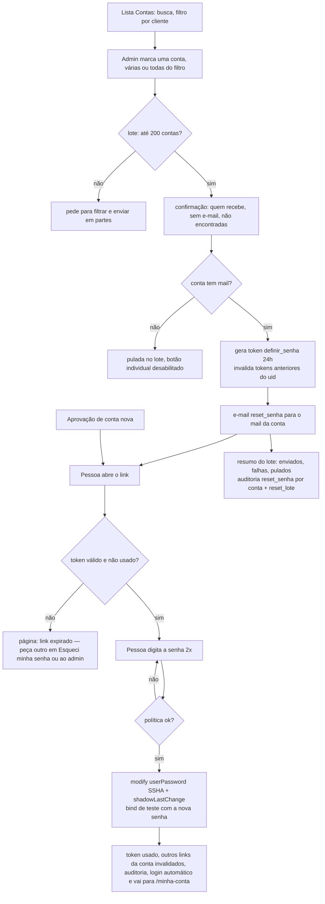

## 4b. Confirmação dos dados (v0.6)

Na lista **Contas** o admin pede, por linha ou em lote (mesmo limite de 200 e mesma tela de confirmação do reset),
que a pessoa confira os dados de cadastro. A conta precisa ter e-mail. Cada pedido gera um token `confirmar_dados`
(alvo = uid, invalida os anteriores do uid) e o e-mail `confirmar_dados`. A tela pública `/confirmar-dados/<token>`
mostra os dados atuais do LDAP (503 se o LDAP estiver fora). "Meus dados estão corretos" (`POST /confirmar-dados/<token>`,
exige consentimento e CPF e telefone no LDAP) segue para definir a senha. "Preciso corrigir"
(`/confirmar-dados/<token>/corrigir`) abre o formulário: `contas.campos_alterados` compara pelo `cn` derivado do nome
e com telefone e e-mail do LDAP normalizados, e sem mudança real o caminho é o mesmo de "corretos". Com mudança, o
token é consumido e nasce uma solicitação `origem=alteracao` pendente (só `uid_sugerido` = uid), que expira a
alteração pendente anterior da mesma conta. Cadastro público ou convite novo nunca expira uma alteração pendente. O admin
aprova (`modify` no LDAP, depois e-mail `dados_atualizados` com o link para definir a senha) ou rejeita (o aviso
`alteracao_rejeitada` vai ao e-mail atual do LDAP, nunca ao novo). O aviso ao admin usa `nova_solicitacao` com a
variável `alteracao`, que troca assunto e texto para "correção de dados para revisar".

**Atenção:** aprovar uma alteração que muda o e-mail envia o link de definir senha ao e-mail novo, que não foi
verificado. Trate a troca de e-mail como o caso sensível ao revisar.

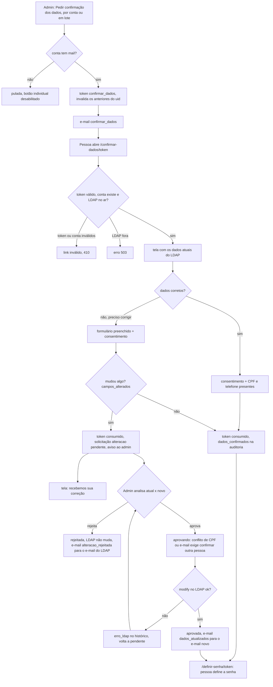

Tokens e e-mails da v0.6: finalidade de token `confirmar_dados` (validade `TOKEN_TTL_HOURS`); e-mails
`confirmar_dados` e `dados_atualizados`, ambos com modelo no tema padrão e sobrescrevíveis pelo tema do deploy.
Rotas públicas: `GET/POST /confirmar-dados/<token>` e `GET/POST /confirmar-dados/<token>/corrigir`. Rotas do painel:
`POST /admin/contas/<uid>/confirmacao`, `POST /admin/contas/confirmacao-lote/confirmar` (tela de confirmação) e
`POST /admin/contas/confirmacao-lote` (envio).

## 4c. Área do usuário e esqueci minha senha (v0.7)

`/entrar` valida usuário e senha por bind no LDAP e grava `session["usuario"]`, sem `session.clear()`. `/minha-conta`
lê tudo do LDAP (CPF mascarado, grupos) e mostra os `links` do tema. A correção pela home usa o mesmo
`registrar_alteracao` da correção por link: se o e-mail informado difere do da conta, a alteração nasce
`aguardando_confirmacao` e o `confirmar_email` vai ao endereço novo. Só em `/confirmar-email/<token>` ela passa a
`pendente` e o admin é avisado.

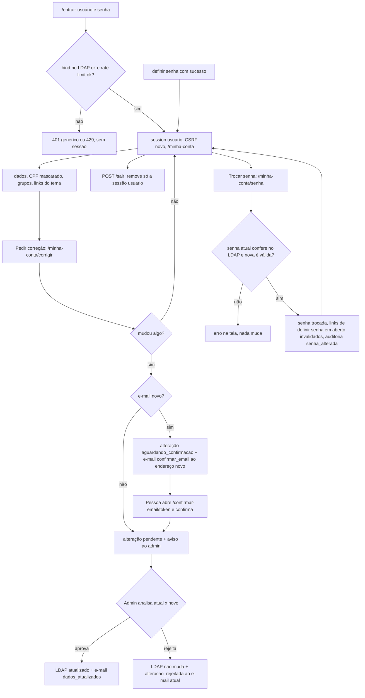

**Esqueci minha senha** (`/esqueci-senha`): a resposta é idêntica para qualquer e-mail, e o trabalho por conta roda em
uma thread (`Servicos.em_segundo_plano`), então nem o conteúdo nem o tempo de resposta revelam se o e-mail existe. Há um
intervalo de 15 minutos por conta (lido da auditoria) e o pedido não invalida links que a conta já tem.

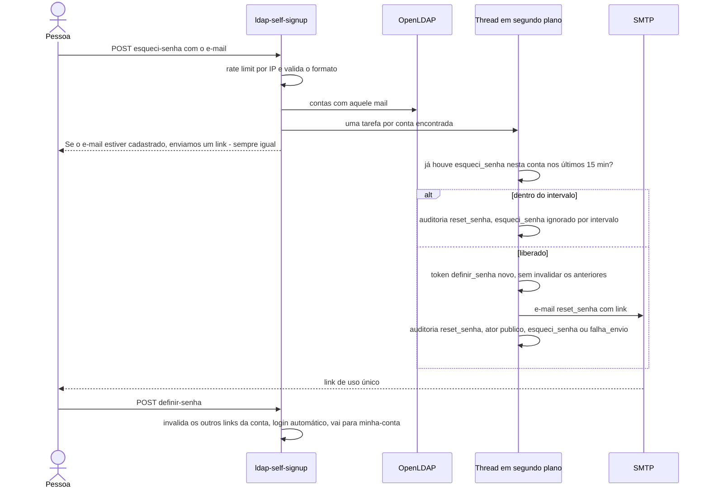

## 5. Estados da solicitação

`aguardando_confirmacao` (e-mail ainda não confirmado) → `pendente` → `aprovando` (reivindicada, transitório) →
`aprovada`, ou `rejeitada`. `expirada` quando a confirmação vence ou uma solicitação mais nova do mesmo CPF a substitui (a alteração de dados não
expira nem é expirada por cadastro novo: só uma nova alteração da mesma conta a expira). A alteração nasce `pendente`, ou `aguardando_confirmacao` quando corrige o e-mail (o admin só é avisado após a confirmação; o prazo conta do consentimento e vale `expirar_aguardando`).
`aprovando` volta a `pendente` quando o LDAP falha na aprovação ou quando o admin usa **Voltar para pendente**.
Convites nascem `convidado`: o aceite sem mudanças passa por `aprovando` até `aprovada` (falha no LDAP volta a
`convidado`); o aceite com mudanças vai a `pendente` ou `aguardando_confirmacao`; cancelar ou substituir leva a `expirada`. O convite por e-mail (`origem = convite_email`) nasce `convidado` só com o
e-mail e vai direto a `pendente` quando a pessoa preenche nome, CPF e telefone (e-mail já comprovado pelo link).

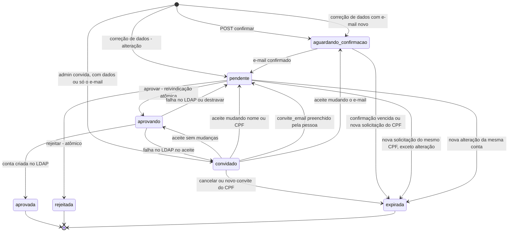
